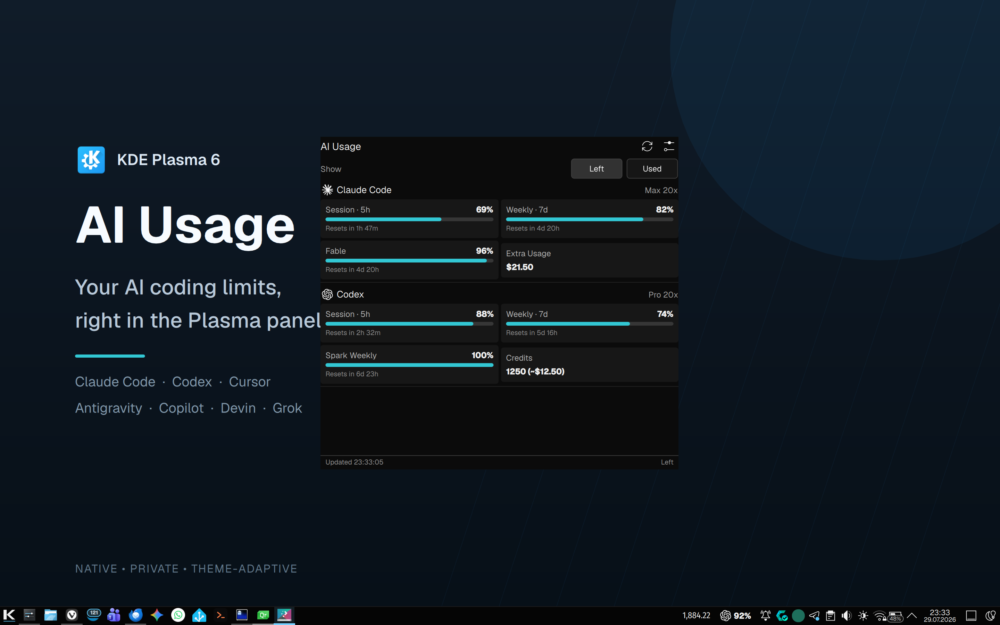
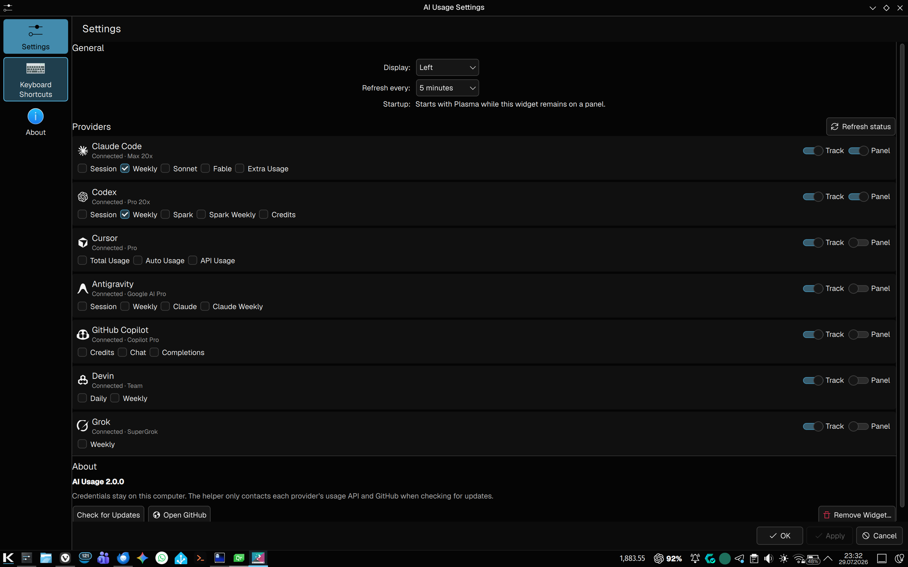

<div align="center">

# Hearthside — your AI companion

**Usage meters and AI chats, right in your Plasma panel.**

[](https://kde.org/plasma-desktop/)
[](https://www.python.org/)

[](LICENSE)

<br>



</div>

Hearthside is a KDE Plasma 6 companion for your AI coding subscriptions. It
sits in the panel, shows how much of each plan you have left, and opens quick
chats with AI websites in its popup. Usage meters cover the same seven
providers supported by the macOS AI Usage menubar app:

- Claude Code
- Codex
- Cursor
- Antigravity
- GitHub Copilot
- Devin
- Grok

It shows each available quota, plan, reset time, extra usage or credits. The
panel can show any combination of providers and metrics. Both the popup and
panel support **Left** and **Used** display modes.

## Features

- Detects installed tools through the Plasma login environment, CLI names, and
  Linux/XDG data locations.
- Contacts only providers that are both installed and tracked.
- Keeps successful readings in Plasma session memory when a temporary or
  rate-limit error occurs; usage history is never written to disk.
- Refreshes rotating OAuth credentials back to their exact source with
  compare-before-write protection.
- Uses Linux Secret Service through `secret-tool` without placing secrets in
  process arguments.
- Uses Plasma's standard configuration dialog and starts with Plasma while it
  remains on a panel.
- **Chat** tab, the first tab in the popup (the usage view is second): pick Claude, ChatGPT, Grok,
  Gemini (best effort), GitHub Copilot, Microsoft Copilot, or Local
  (Ollama / Open WebUI) from a dropdown and use the site right in the popup.
  It runs in a private, in-memory browser profile: you sign in on each site
  normally, nothing is saved to disk, and you are signed out when Plasma
  restarts or you choose **Clear chat data**. Choose the sites under
  **Settings → Chat**; Local is off until you turn it on.

### Chat sites

- **GitHub Copilot** opens GitHub's sign-in page and goes on to
  `github.com/copilot` once you are signed in (signed-out visitors to
  `/copilot` only get a landing page). Google and Apple sign-in may be
  refused inside the widget; GitHub's own sign-in and two-factor prompts work.
- **Local (Ollama / Open WebUI)** shows a chat web interface running on this
  computer, by default `http://localhost:3000/`. Ollama alone has no web
  interface; run [Open WebUI](https://github.com/open-webui/open-webui) on top
  of it, for example
  `docker run -d -p 3000:8080 --add-host=host.docker.internal:host-gateway -v open-webui:/app/backend/data --name open-webui ghcr.io/open-webui/open-webui:main`
  (or `open-webui serve`, which listens on port 8080; set that address below).
- **Custom addresses**: under **Settings → Chat → Show advanced settings**
  each site can open a different address, for example a self-hosted
  instance. Leave a field empty to use the built-in address. Addresses must
  use `https://`; only Local may also use plain `http://`, and only for this
  computer (`localhost`, `127.0.0.1`, `[::1]`). A custom address adds only its
  exact host to the site, never its subdomains. Don't put passwords or tokens
  in an address; it is stored in your Plasma configuration file. The widget
  never opens a page, window or embedded frame on this computer for any site
  but Local, and for Local allows plain `http://` only at the configured
  address; background requests a page makes itself (fetch, WebSocket, images)
  aren't filtered, as in any browser. See [docs/privacy.md](docs/privacy.md).
- **A chat server on another machine** (for example Open WebUI on your home
  server): give it an `https://` address with a certificate your system
  trusts (self-signed certificates are refused), or forward it to this
  computer with an SSH tunnel such as `ssh -N -L 3000:localhost:3000 server`
  (use `ssh -N -L 3000:server:3000 gateway` when it runs on a third machine)
  and keep Local at `http://localhost:3000/`.

Fresh installs track all providers, show Claude Code and Codex in the panel,
select Weekly for each, display usage left, and refresh every five minutes.

## Configure every provider

Track only the tools you use, choose which providers appear in the Plasma
panel, and select one or more metrics per provider.



## Install

```bash
./scripts/install.sh --restart-plasma
```

The script removes the old AI Usage widget, helper, and cache if they are
present, installs the dependency-free Python helper into the user Python site,
installs or upgrades the plasmoid, and optionally reloads Plasma.

Then right-click the panel, choose **Add Widgets…**, search for **Hearthside**,
and add it. The first launch opens Settings once.

Manual installation remains available:

```bash
python3 -m pip install --user --break-system-packages .
kpackagetool6 -t Plasma/Applet -i plasmoid
```

Use `-u plasmoid` instead of `-i` when the package is already installed.
When upgrading from AI Usage 2.x by hand, remove the old helper and widget
first, so the two never refresh the same sign-ins at once:

```bash
python3 -m pip uninstall --break-system-packages ai-usage-kde
kpackagetool6 -t Plasma/Applet -r com.bgn.aiusage
```

## Upgrading from AI Usage 2.x

Hearthside 1.0.0 is the renamed AI Usage 2.x. Run the installer once:

```bash
./scripts/install.sh --restart-plasma
```

It removes the old `com.bgn.aiusage` widget, the old `ai-usage-kde` Python
helper, and the old cache files in `$XDG_CACHE_HOME/ai-usage-kde`. After Plasma
reloads, remove the old widget's placeholder from your panel if it is still
there, then add **Hearthside** once through **Add Widgets…**. Settings start
fresh because the widget has a new ID. Nothing needs to be re-authenticated:
Hearthside reads the same provider sign-ins as before.

## Helper CLI

```bash
hearthside --json
hearthside --providers=claude,codex
hearthside --catalog
hearthside --detect
```

The JSON v2 response includes the provider catalog, detected provider IDs,
status/failure classification, available metrics, quota windows, billing
usage, reset/retry times, and no credential data.

## Requirements

- KDE Plasma 6 and Qt 6
- Python 3.11 or newer; standard library only
- `secret-tool` when a provider stores its session in Linux Secret Service
- For the Chat tab only: Qt WebEngine 6.8 or newer with its QML module
  (Arch: `qt6-webengine`; Fedora: `qt6-qtwebengine`; Debian/Ubuntu:
  `qml6-module-qtwebengine`; package names may vary). It also needs the Qt
  Quick Dialogs QML module, usually already installed with Plasma (Arch:
  `qt6-declarative`; Debian/Ubuntu: `qml6-module-qtquick-dialogs`). Without
  these the usage view works as before and the Chat tab explains what to
  install. Each open
  chat site uses roughly 200–500 MB of memory until Plasma restarts or you
  clear chat data.

## Privacy

No tokens, credential fingerprints, raw API responses, local transcripts, or
usage history are printed or cached. Antigravity's derived access-token cache
is the only authentication cache created by Hearthside; it is stored with mode
`0600` under `$XDG_CACHE_HOME/hearthside` and keyed to a one-way refresh-token
fingerprint.

The Chat tab keeps cookies, sessions, and site data in memory only, denies
every site permission (microphone, camera, screen sharing, notifications,
location, clipboard reading), asks before each download, opens outside links
in your browser (which may keep them in its history), and never reads or
scripts the pages. Page console messages
are discarded. Custom chat addresses are stored in plain text in your Plasma
configuration file. The [Chat tab privacy notes](docs/privacy.md#chat-tab) also
list what it does not protect against.

See [Privacy](docs/privacy.md) and
[Provider contracts](docs/provider-contracts.md).

## Development

```bash
python -m venv .venv
source .venv/bin/activate
python -m pip install -e ".[test]"
QT_QPA_PLATFORM=offscreen python -m pytest
python3 -m compileall -q src
qmllint plasmoid/contents/ui/*.qml
QT_QPA_PLATFORM=offscreen /usr/lib/qt6/bin/qmltestrunner -input tests/qml
```

## License

[MIT](LICENSE)
